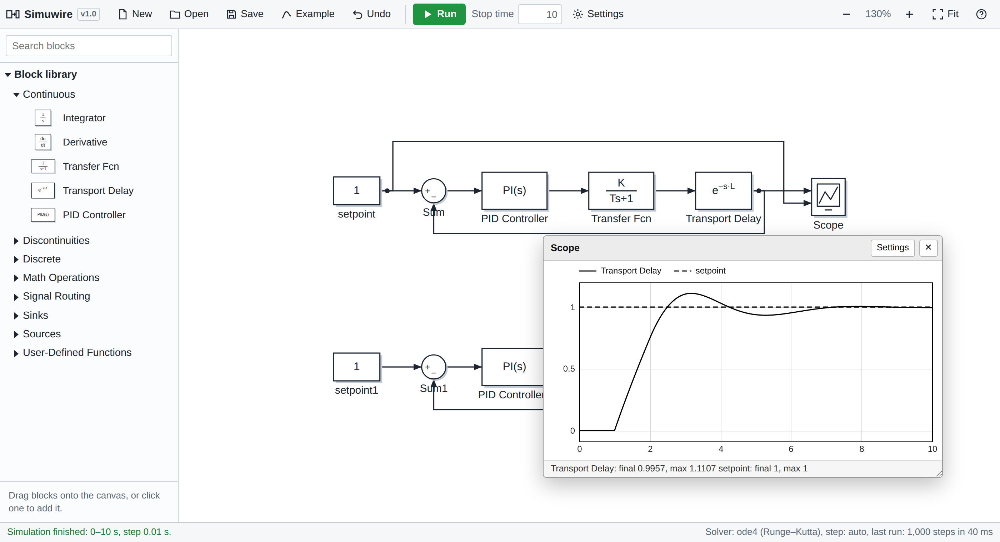

# Simuwire

**Block diagram simulation in your browser.** Build control loops by dragging blocks and wires, run them, and read the results on a scope. No installation, no license, no server: Simuwire is a single HTML file.

It can also open Simulink `.slx` files directly, so models you built in the past keep running after your MATLAB license is gone.

## Try it

- **Online:** open the GitHub Pages link of this repository (see *Hosting* below).
- **Offline:** download `index.html` and open it in any modern browser (Chrome, Edge, Firefox, Safari).

Click **Examples** to load one of the built-in models. The same models are also in [`examples/`](examples/): basic system responses, a mass-spring-damper, the Van der Pol oscillator, sampling, and PID control of a first-order-plus-dead-time (FOPDT) process with Ziegler–Nichols and SIMC tuning. Press **Run**.

## Features

- Simulink-style editor: block library, drag-and-drop, orthogonal wiring, branches, draggable wire segments, block flipping, undo
- Fixed-step solvers: `ode4` (Runge–Kutta, default) and `ode1` (Euler), with automatic step selection
- MATLAB-style parameters: numbers, vectors like `[T 1]`, expressions like `2*K`, and model variables defined once in Settings
- Scope windows with multiple inputs, hover readout, and a black-and-white style that prints well
- Opens Simulink `.slx` files: blocks, positions, connections, model workspace variables and stop time are read automatically
- Saves models as `.json` files; the current model is also kept in the browser between sessions
- Detects algebraic loops and unconnected inputs, and highlights the block that caused an error
- Light and dark mode, works on tablets and phones

## Blocks in v1.0

| Category | Blocks |
|---|---|
| Continuous | Integrator, Derivative, Transfer Fcn, Transport Delay, PID Controller |
| Discontinuities | Saturation, Dead Zone |
| Discrete | Unit Delay, Zero-Order Hold |
| Math Operations | Sum, Gain, Product, Abs |
| Signal Routing | Switch |
| Sinks | Scope, Display |
| Sources | Constant, Step, Sine Wave, Ramp, Pulse Generator, Clock |
| User-Defined Functions | Fcn (e.g. `2*u^2 + sin(t)`) |

The PID Controller supports P, PI, PD, PID and I types, parallel and ideal forms, and a first-order derivative filter (coefficient N).

## Validation

A PI controller (Kp = 1, Ki = 1) on the plant 1/(s+1) with a 1 s transport delay was simulated in both Simulink and Simuwire. The responses match: a 1.5 peak at t ≈ 3 s, a dip to about 0.76 at t ≈ 5.3 s, and a value of 0.947 at t = 10 s. The `.slx` version of `examples/pid/pi_fopdt_with_and_without_dead_time.json` was also imported and checked against an independent Python simulation of the same loop.

## Importing `.slx` files

Use **Open** and pick an `.slx` file. Supported blocks are converted automatically; unsupported ones (for example subsystems or Stateflow charts) appear with a dashed outline so you can see what needs to be rebuilt. Variables stored in the model workspace are loaded into Settings; variables that lived only in the MATLAB base workspace are set to 1 and listed so you can enter their values.

`.slx` files are only read, never modified.

## Keyboard shortcuts

| Key | Action |
|---|---|
| Ctrl+T | Run the simulation |
| Ctrl+S | Save the model to a file |
| Ctrl+Z | Undo |
| Ctrl+I | Flip the selected block |
| Delete | Delete the selected block or line |
| Enter | Open the selected block’s parameters |
| Space | Fit the model to the view |

Drag a wire segment to move it, double-click a wire to return it to automatic routing, and Ctrl+drag a wire to branch it.

## Hosting on GitHub Pages

1. Push this repository to GitHub.
2. Go to **Settings → Pages**, choose **Deploy from a branch**, select `main` and `/ (root)`, and save.
3. After a minute the app is live at `https://<your-username>.github.io/<repository-name>/`.

## Roadmap

- Subsystems
- Mux/Demux and vector signals
- Scope export to PNG and CSV
- Derivative on measurement (setpoint weighting) for the PID block
- Variable-step solver

## How it works

Everything runs in the browser. The `.slx` reader unzips the file and parses its XML; a small expression evaluator handles MATLAB-style parameters; the engine orders blocks by signal flow and integrates continuous states with a fixed-step Runge–Kutta method. The only external dependency is [JSZip](https://stuk.github.io/jszip/), loaded from a CDN, for reading `.slx` files.

## Disclaimer

Simuwire is an independent project and is not affiliated with, endorsed by, or sponsored by The MathWorks, Inc. MATLAB and Simulink are registered trademarks of The MathWorks, Inc.

## License

[MIT](LICENSE)
